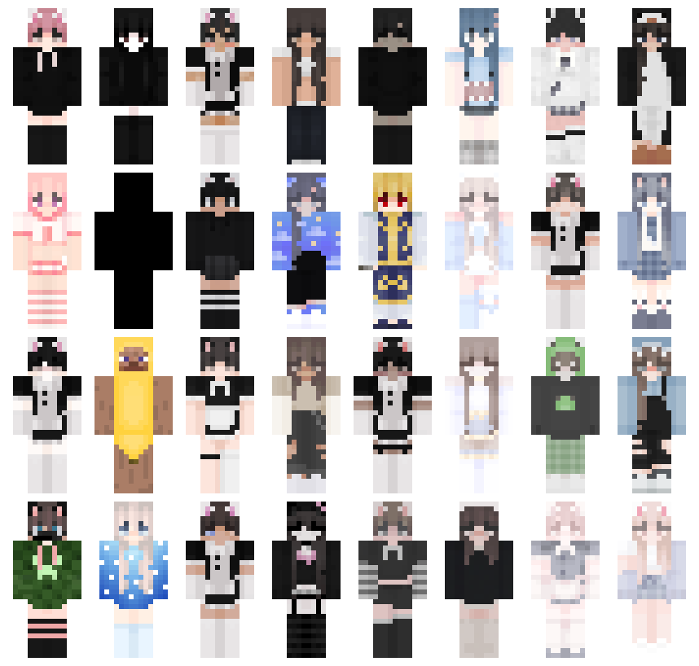
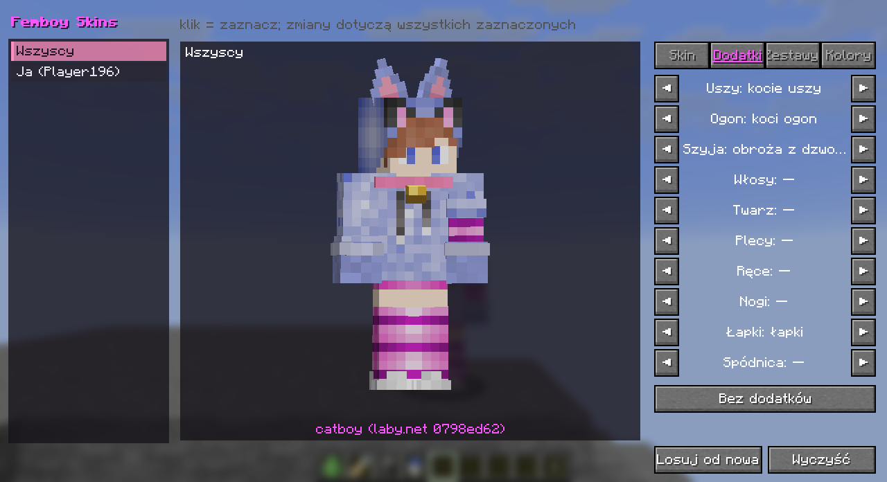
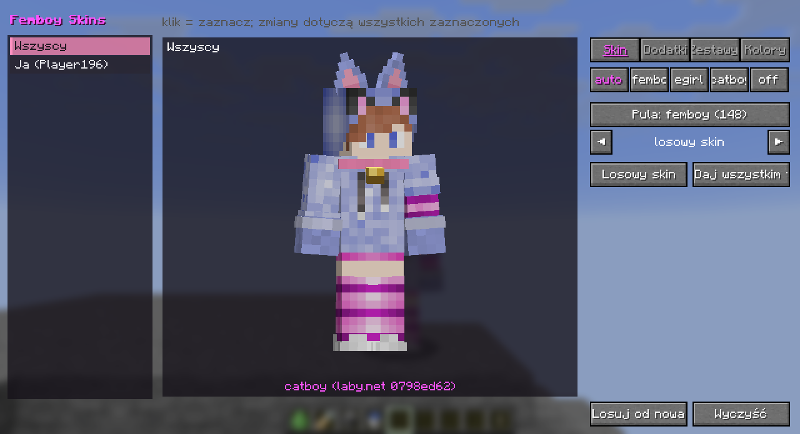
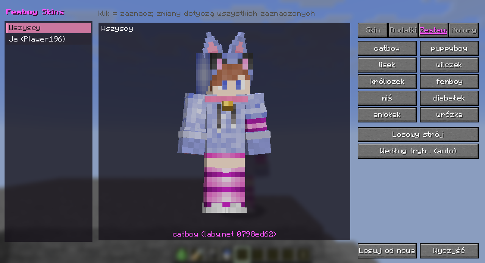
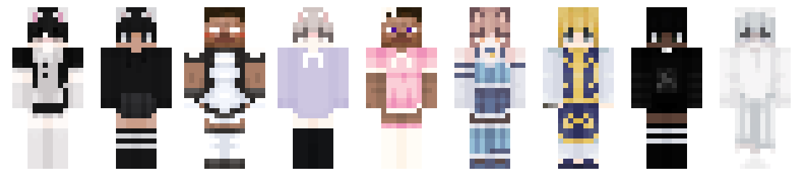
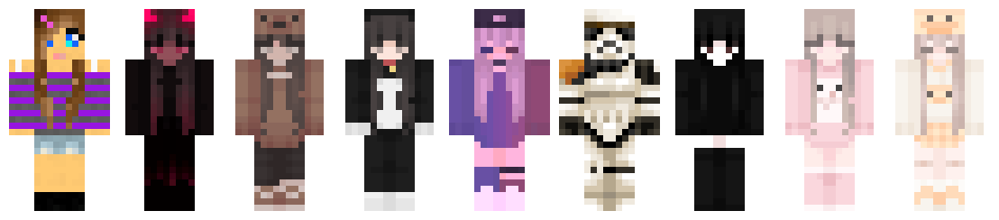
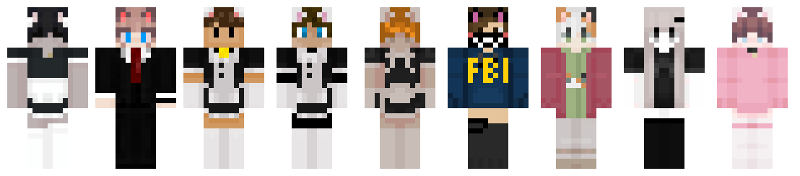
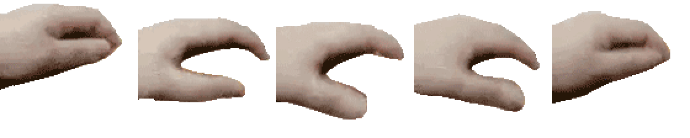
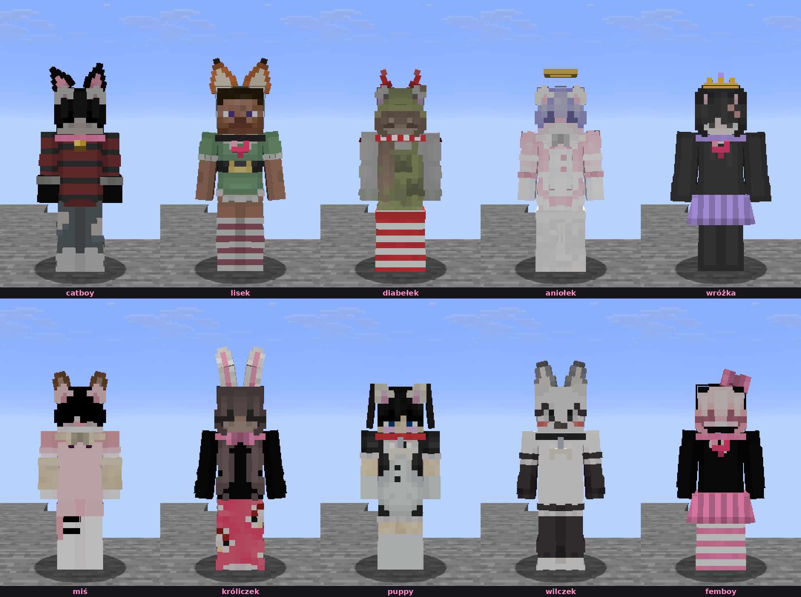
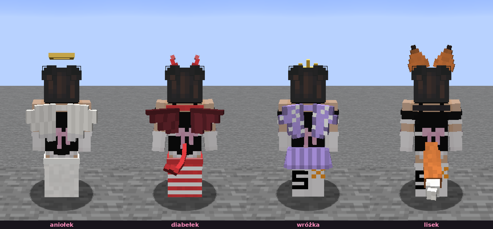

# Femboy Skins

Mod do Minecrafta (Fabric, tylko klient), który zamienia skiny wszystkich graczy
na skiny femboyów, e-girls i catboyów, dokłada dodatki 3D (uszy, ogony, skrzydła, aureolki, różki,
obroże…), głaskanie
oraz **okno wyboru wyglądu z żywym podglądem**. Wszystko widoczne tylko u ciebie.

Zbudowany i sprawdzony na **Minecraft 1.21.11** (Fabric). Inne wersje wymagają przeniesienia
kodu - patrz [Budowanie na różne wersje](#budowanie-na-różne-wersje).

<p align="center">
  
</p>

## Okno wyboru wyglądu (GUI)

<p align="center">
  
</p>
<p align="center">
  
  
</p>

Wciśnij **G** (albo wpisz `/femboy gui`) i ustaw wszystko myszką, bez komend:

- **Po lewej - kogo zmieniasz.** Klikasz, żeby zaznaczyć dowolną liczbę osób: jedną,
  kilka, „Ja” albo **Wszyscy**. Każda zmiana leci do wszystkich zaznaczonych naraz -
  więc możesz dać np. całemu serwerowi ten sam skin jednym kliknięciem.
- **W środku - żywy podgląd 3D** zaznaczonej postaci: od razu widać skin i dodatki,
  obraca się za kursorem, a każda zmiana jest widoczna natychmiast.
- **Po prawej - zakładki z mnóstwem opcji** (za długą listę przewijasz kółkiem):
  - **Skin** - styl (`auto` / `femboy` / `egirl` / `catboy` / `off`), przeglądanie całej puli
    skinów (wybierasz konkretny skin strzałkami - też skin, który nosi ktoś inny), „losowy”
    albo „daj wszystkim ten sam”.
  - **Dodatki** - 11 miejsc: uszy, ogon, szyja, włosy, twarz, plecy, ręce, nogi, łapki,
    spódniczka, zabawka w ręce (każde strzałkami) i „bez dodatków”.
  - **Zestawy** - 10 gotowych strojów jednym kliknięciem, „losowy strój”, „według trybu”.
  - **Kolory** - futro i kolor dodatków z całej palety, „futro = kolor włosów”, „losowy”.
  - **Dźwięk**, **Zabawa** (clicker, smycz, na kogo reagujesz, boop / przytulas / ręce / noszenie, emotki),
    **Animacje** (wszystkie pozy), **Zabawki** (laser, włóczka, ślady łapek), **Szafa** (zapisane stroje)
    i **Klawisze**.
- Na dole: **Losuj od nowa** i **Wyczyść** - dla wszystkich zaznaczonych.

To samo, co komendy `/femboy …`, tylko wygodniej i z podglądem. Wszystkie zdjęcia z gry w tym
README zrobił sam mod (`./gradlew runShots`, patrz [Zrzuty z gry](#zrzuty-z-gry)).

## Skiny

Do wyboru masz ok. **450 wbudowanych skinów** (po ~150: femboy, e-girl i **catboy** - najpopularniejsze
z tagu [catboy na laby.net](https://laby.net/skins/tag/catboy), bez powtórek z pozostałych pul; od razu w jarze - komu dasz sam
plik `.jar`, ten ma je bez kopiowania żadnych folderów), **generator**, który sam rysuje wygląd
(włosy, oczy, bluza / sweter / mundurek, spódniczka, podkolanówki, buty, dodatki), albo jedno
i drugie naraz.

- `/femboy source skins` - tylko gotowe skiny
- `/femboy source generated` - tylko generator
- `/femboy source mix` - pół na pół

`/femboy mode femboy | egirl | catboy | mix` wybiera, kto jaki skin dostaje (`mix` = po równo ze
wszystkich trzech). Każdy gracz dostaje skin wylosowany według swojego UUID. Dopóki w puli są wolne skiny, dwie osoby
nie mają tego samego. Ten sam gracz zwykle ma ten sam skin, dopóki nie zrobisz rerolla
(jeśli jego skin nosi już ktoś inny, dostaje następny wolny).

**femboy**

<p align="center">
  
</p>

**e-girl**

<p align="center">
  
</p>

**catboy**

<p align="center">
  
</p>

## Pat pat (głaskanie)

<p align="center">
  
</p>

Trzymaj **R**, celując w kogoś (do 6 bloków): nad jego głową pojawia się ręka z GIF-a petpet
i klepie go, dopóki nie puścisz. Głowa ściska się w rytm klepania jak obrazek w GIF-ie,
a przy każdym klepnięciu piszczy gumowa zabawka. Działa też na moby (zwierzaki!) - im ściska się całe ciało.
Klawisz zmienisz w Ustawienia → Sterowanie → Przypisane klawisze → Femboy Skins (np. gdy masz Irisa z R na przeładowanie shaderów). Widać to tylko u ciebie (mod działa po stronie klienta).

## Dodatki (uszy, ogony, skrzydła, aureolki…)

Wszystkie 10 gotowych zestawów w grze:

<p align="center">
  
</p>

Z tyłu - skrzydła, ogony, różki, aureolka, tiara:

<p align="center">
  
</p>

Każdy gracz może mieć dodatki 3D - siedzą na postaci i ruszają się razem z nią:

- **uszy** (`ears`): kocie `cat`, lisie `fox`, wilcze `wolf`, oklapnięte psie `puppy`, królicze `bunny`,
  misie `bear`, mysie `mouse`, kocie z dzwoneczkami `catbell`
- **ogon** (`tail`): koci `cat`, puszysty lisi `fox` i wilczy `wolf`, psi `puppy`, króliczy puszek `bunny`,
  diabelski `devil`
- **szyja** (`neck`): obroża z dzwoneczkiem `bell`, obroża z kostką `tag`, choker z serduszkiem `heart`,
  choker z kokardką `bow`, z kłódką `lock`, z ćwiekami `spikes`, obroża z identyfikatorem `id`
  (na blaszce jest nick - czytelny z bliska), obroża z trzema dzwoneczkami `bells`, szalik `scarf`
  (powiewa na wietrze, przy bieganiu koniec leci za tobą)
- **włosy** (`head`): kokardka `bow`, spinka-serduszko `clip`, aureolka `halo`, diabelskie różki `horns`,
  tiara `tiara`, kwiatek `flower`, kokardka z dzwoneczkiem `bellbow`
- **twarz** (`face`): okulary `glasses`, maseczka `mask`
- **plecy** (`back`): anielskie skrzydła `angel`, skrzydła nietoperza `bat`, skrzydła motyla `butterfly` -
  trzepoczą, przy bieganiu i głaskaniu mocniej, przy skradaniu się składają
- **ręce** (`arms`): ocieplacze `warmers`, ocieplacze w paski `stripes`
- **łapki** (`paws on|off`) i **plisowana spódniczka** (`skirt on|off`)
- **efekt** (`fx`): stałe serduszka nad głową `hearts` albo iskierki `sparkles`

Wszystko, co ma **dzwoneczek** (obroże `bell`/`bells`, kokardka `bellbow`, uszy `catbell`), dzwoni przy chodzeniu -
przy skradaniu ciszej (`/femboy bells off` wyłącza).

Do tego nowe uszy: misie `bear` i mysie `mouse`; ogon diabełka `devil`; chokery z kłódką `lock`
i z ćwiekami `spikes`.

Gotowe zestawy: `catboy`, `puppy`, `fox`, `wolf`, `bunny`, `femboy`, `bear` (miś), `devil` (diabełek),
`angel` (aniołek), `fairy` (wróżka). Futro (`fur`) ma domyślnie kolor
włosów ze skina (`auto`), a reszta (`color`) - wybrany kolor: `pink`, `black`, `lightblue`, `ff88cc`…
Uszy co kilka sekund strzygą, przy głaskaniu kładą się po sobie, koci ogon się kołysze, psi merda
(najmocniej przy bieganiu i głaskaniu), a spódniczka rusza się z nogami.

Tryby (`/femboy acc mode`):
- `random` (domyślny) - każdy dostaje coś losowego z włączonych zestawów
- `same` - wszyscy noszą ten sam strój (`/femboy acc all …`), futro każdy ma w kolorze swoich włosów
- `me` - dodatki ma tylko twoja postać (i gracze, którym ustawisz strój)

Przykłady:
- `/femboy acc me catboy` - ty jako catboy
- `/femboy acc me tail fox` - zmień sobie tylko ogon, `/femboy acc me neck none` - zdejmij obrożę
- `/femboy acc me fur white`, `/femboy acc me color black` - kolory
- `/femboy acc all puppy` i `/femboy acc mode same` - wszyscy jako puppyboye
- `/femboy acc player Nick bunny` - jedna osoba jako króliczek
- `/femboy acc kits wolf off` - bez wilków w losowaniu
- `/femboy acc items` - lista wszystkich dodatków i kolorów

Jak wszystko w tym modzie, dodatki widzisz tylko ty. Kolega z modem widzi to, co sam ustawi u siebie
(np. `/femboy acc player <twój nick> catboy`).

## Reakcje, emotki, clicker, smycz

- **Uszy i ogon reagują** na odgłosy i obrażenia: po syku, warczeniu albo ciosie uszy kładą się po sobie, a ogon
  się stroszy; przy miau uszy się stawiają; przy hau ogon merda jak szalony (`/femboy react off` wyłącza).
- **Głaskanie**: nad głaskanym lecą serduszka, a głaskany kot (kocie uszy albo ogon) mruczy, dopóki go głaszczesz
  (`/femboy hearts`, `/femboy purr`).
- **Emotki nad głową** (♥ ? ! złość, nutka, zzz, gwiazdka, łezka) - pod klawiszami (domyślnie Num 1-4),
  z okna moda albo `/femboy emote <nazwa>`. Widzą je inni gracze z modem, tak jak słyszą odgłosy.
- **Clicker** (klawisz **V**) - domyślnie **wyłączony**; włączasz go w oknie moda (zakładka Zabawa) albo
  `/femboy clicker on`. Kto ma go włączonego i usłyszy czyjś klik, sam obraca się w stronę klikającego.
- **Smycz** (klawisz **B**, celując w gracza - drugi raz puszcza) - linka od twojej ręki do szyi drugiej osoby,
  widoczna dla wszystkich z modem. Prowadzony jest naprawdę ciągnięty tylko, gdy sam włączy u siebie
  „Daję się ciągnąć” (`/femboy leashpull on`); skradanie = stawia opór. Także `/femboy leash <gracz> | off`.

- **Na kogo reagujesz**: przy clickerze, smyczy, zabawkach i noszeniu jest pole tekstowe z nickami - jeden nick
  w linijce. Gdy pole jest aktywne, kliknięcie gracza na liście obok dopisuje jego nick (i nie zmienia zaznaczenia).
  „Tylko wybrane osoby” zawęża reakcję do tej listy (także `/femboy trust clicker|leash|laser|carry <gracz> on|off`).
  Osoba na smyczy domyślnie **nie widzi linki** (dostaje tylko napis nad paskiem, kto ją prowadzi);
  `/femboy leashsee on` pokazuje ją z powrotem.

## We dwoje, animacje, zabawki, szafa (1.7.0)

- **Boop w nosek** (klawisz **N**, celując w gracza) - druga osoba mruga i lekko się wzdryga, słychać „boop”,
  leci iskierka.
- **Przytulas** (trzymaj **H** przy kimś), **trzymanie się za ręce** (**J**, dopóki idziecie obok siebie),
  **noszenie na rękach** (**K**) i **na barana** - noszenie jest tylko wizualne i działa dopiero, gdy niesiona
  osoba sama się zgodzi (klawisz **K** u niej albo wpisanie cię na listę „mogą mnie nosić bez pytania”). Niesiony
  nie steruje wtedy postacią - sama trzyma się niosącego, dopóki ten jej nie puści; **K** u niesionego to zejście.
- **Kocie animacje** pod klawiszami (domyślnie Num 5-9, reszta do ustawienia): siad, ugniatanie łapkami, bochenek,
  brzuszek do głaskania, drzemka w kłębku, proszenie, taniec, przeciąganie, machanie, daj łapę, mycie łapki,
  czajenie się przed skokiem, otrzepanie się, ocieranie główką. **Same z siebie**: bochenek po dłuższym kucaniu
  w miejscu, przeciąganie po wstaniu z łóżka, z ziemi (siad, drzemka, brzuszek…) albo po długim AFK, mruganie, ogon drgający przy skradaniu
  (`/femboy autopose`, `/femboy blink`). Także `/femboy pose <nazwa>|stop`.
- **Kółko animacji** (klawisz **Y**): przytrzymaj, najedź myszką na pozę i puść - postać ją zagra. Krótkie stuknięcie
  zostawia kółko otwarte (wtedy wybierasz kliknięciem), środek kółka przerywa trwającą animację.
- **Zabawki**: laserowy wskaźnik (trzymaj **U**) - czerwona kropka na blokach, catboye wodzą za nią głową, a kto
  włączy u siebie „Chodzę za laserem” (`/femboy laserfollow on`, domyślnie wyłączone), ten za nią idzie;
  „Gonię cudze kłębki” (`/femboy yarnfollow on`, też domyślnie wyłączone) każe postaci biec za włóczką i ją kopać.
  Sterowanie zawsze wygrywa: dowolny klawisz ruchu albo ruch myszką przerywa gonienie na 3 sekundy, kucnięcie kończy
  gonienie tego kłębka na dobre, a jeden kłębek postać goni najwyżej kilka sekund;
  kłębek włóczki (**I**) - turla się i można go kopać; myszka albo piórko na wędce w nowym miejscu „w ręce”.
- **Ślady łapek** na śniegu i piasku (`/femboy pawprints`), **licznik głaskań** na plakietce z imieniem
  („❤ 142×”) i w oknie moda.
- **Szafa**: zapisujesz stroje pod nazwami w zakładce Szafa i przełączasz je tam albo klawiszem **O**
  (`/femboy wardrobe save|wear|remove <nazwa>`, `/femboy wardrobe next`).

Wszystko to widzą inni gracze z modem; kto go nie ma, nie widzi nic.

**Język:** okno moda i komunikaty są po polsku, gdy gra jest ustawiona na polski, a w każdym innym języku po angielsku.

**Wszystkie klawisze moda** (okno, głaskanie, odgłosy, emotki, clicker, smycz, boop, przytulas, animacje, zabawki,
szafa) ustawisz w oknie moda w zakładce **Klawisze** - albo jak dotąd w Sterowaniu gry.

## Komendy

- `/femboy gui` - okno wyboru wyglądu z podglądem (albo klawisz **G**)
- `/femboy on | off | toggle` - włącz / wyłącz
- `/femboy mode femboy | egirl | catboy | mix` - kto jaki skin dostaje (mix = po równo ze wszystkich)
- `/femboy source skins | generated | mix` - pobrane skiny / generator / jedno i drugie
- `/femboy reroll [gracz]` - nowe losowanie dla wszystkich albo jednej osoby
- `/femboy set <gracz> femboy | egirl | catboy | auto | off` - wybór dla jednej osoby (`off` = oryginalny skin)
- `/femboy reset [gracz]` - usuwa ustawienia graczy
- `/femboy self on|off` - czy zmieniać też twój skin
- `/femboy tab on|off` - główki na liście graczy (TAB)
- `/femboy layers on|off` - pokazuj warstwy skina (włosy 3D, spódniczka), nawet gdy gracz je wyłączył
- `/femboy pat on|off` - głaskanie pod klawiszem, `/femboy patsound on|off` - piszczenie
- `/femboy emote <nazwa>`, `/femboy clicker on|off|click`, `/femboy leash <gracz>|off`, `/femboy leashpull on|off`
- `/femboy pose <nazwa>|stop`, `/femboy boop | hands | carry | piggy <gracz>`, `/femboy yarn`
- `/femboy wardrobe [save|wear|remove <nazwa> | next]`, `/femboy trust clicker|leash|laser|carry <gracz> on|off`
- `/femboy clickerpicked | leashpicked | laserpicked | leashsee | laserfollow | yarnfollow | toys | pawprints | blink | autopose on|off`
- `/femboy bells | purr | hearts | react on|off` - dzwoneczki, mruczenie, serduszka, reakcje uszu i ogona
- `/femboy acc on|off` - dodatki 3D (uszy, ogony, obroże…); `/femboy acc` pokazuje wszystkie komendy dodatków
- `/femboy acc mode random | same | me` - losowo każdemu / każdemu to samo / tylko ja
- `/femboy acc me | all | player <gracz> …` - strój: `<zestaw>`, `random`, `none`, `auto`,
  `<miejsce> <dodatek>`, `fur <kolor>`, `color <kolor>`
- `/femboy acc kits [<zestaw> on|off]`, `/femboy acc reroll [gracz]`, `/femboy acc items`
- `/femboy list`, `/femboy status` - kto co ma (z którego pliku) / ustawienia i liczba skinów
- `/femboy export [gracz]` - zapisuje skin do PNG (`config/femboy/export/`), możesz go ustawić jako swój
- `/femboy folder`, `/femboy reload` - folder ze skinami / wczytaj pliki od nowa

## Własne skiny

- **Dla wszystkich** (w jarze): wrzuć PNG (64x64 albo 64x32) do `skins/femboy/`, `skins/egirl/` albo `skins/catboy/`
  w projekcie i zbuduj mod - wszystko z tych folderów trafia do jara. Usunięty stąd skin znika z jara.
- **Tylko u siebie**: wrzuć PNG do `config/femboy/skins/<femboy|egirl|catboy>/`
  w folderze gry i wpisz `/femboy reload`. Dołączą do puli razem z wbudowanymi.

Model chudy / szeroki: słowo `slim` / `wide` w nazwie pliku, a bez niego mod rozpoznaje go
z pikseli (chudy, jeśli miejsca, których chudy model nie używa, są w większości puste).

Ustawienia: `config/femboy.json`.

## Ręka i dźwięk pat pat

- Ręka: klatki z generatora petpet (mem „Pet the X”), wzięte z paczki
  [pet-pet-gif](https://pypi.org/project/pet-pet-gif/) (MIT, camprevail) - 5 klatek po 112 px
  w `assets/femboy/textures/petpet/hand.png`. Animacja jak w generatorze: 10 klatek, ściśnięcie
  najmocniejsze w 5., tylko trochę wolniej (30 ms zamiast 20 ms na klatkę).
- Dźwięk: 4 piśnięcia wycięte z „Squeeze Toy” autorstwa survivalzombie
  ([freesound.org/s/240015](https://freesound.org/people/survivalzombie/sounds/240015/), CC0),
  mono, w `assets/femboy/sounds/petpet/`.

## Budowanie

`./gradlew build --offline` - gotowy jar (razem ze skinami z `skins/`) sam ląduje w modach instancji
Fabulously Optimized (ścieżka `fo_mods_dir` w `gradle.properties`). Ten sam plik możesz dać innym:
`build/libs/femboy-<wersja>.jar` (potrzebują jeszcze tylko Fabric API).

### Budowanie na różne wersje

**Stan na teraz: kod kompiluje się na 1.21.11.** Build jest przygotowany pod inne wersje
(numery podaje się z linii poleceń), ale sam kod jeszcze się na nich nie zbuduje bez zmian -
patrz niżej.

```
./gradlew build -Pmc=1.21.8 -Pyarn=1.21.8+build.1 -Pfabricapi=0.136.1+1.21.8
```

Jary różnych wersji mają inną nazwę (`femboy-mc1.21.8-<wersja>.jar`), więc się nie nadpisują,
a każdy dostaje w `fabric.mod.json` zakres zgodności dla swojej linii. Skrypt
`tools/build-all.sh` dobiera numery z `meta.fabricmc.net` + Modrintha i buduje serię do `dist/`
(nie przerywa się na błędzie - wypisuje, czego nie udało się skompilować).

**Dlaczego to nie jest „za darmo”:** mod wczepia się mixinami w wewnętrzne klasy renderowania,
a Mojang przebudował je nawet w obrębie 1.21.x. Próba buildu na **1.21.8** kończy się błędami
kompilacji - tam nie ma pakietów `net.minecraft.client.render.state` / `…render.command`,
`GameProfile` ma inne metody (`getId()`/`getName()` zamiast `id()`/`name()`), `PlayerEntityRenderer`
nie jest generyczny, a API wejścia GUI (`Click`, `KeyInput`) i `RenderPipelines` wygląda inaczej.
Każda starsza wersja wymaga więc osobnych wariantów tych klas (np. przez *source sety* albo
refleksję). Infrastruktura do tego jest gotowa; samo przeniesienie kodu to oddzielna robota.

### Testy

`./gradlew test` - testy logiki bez uruchamiania gry: czy geometria wszystkich dodatków mieści się
w teksturze 128×128 i nic na siebie nie nachodzi, czy każdy dodatek ma model i widoczne piksele,
zapis/odczyt strojów, losowanie (deterministyczne, zawsze ≥ 2 dodatki, każdy nowy dodatek wypada),
kolory, animacje (skończone wartości) oraz czy wszystkie skiny w `skins/` to poprawne PNG zgodne
z listami z laby.net i bez powtórek między pulami.

### Zrzuty z gry

`./gradlew runShots` uruchamia grę w świecie `run/saves/Femboy Shots` (wystarczy skopiować tam
dowolny świat 1.21.11), sama ubiera postać w kolejne zestawy, robi zdjęcia z przodu, z tyłu i okna
GUI do `docs/img/game/` i się zamyka - niczego nie trzeba klikać. W zwykłej grze ten tryb jest
wyłączony (włącza go tylko flaga `-Dfemboy.shots`).

Potem `python3 -I tools/make_game_gallery.py` składa z nich galerie `docs/img/game-*.png`.
Rzędy skinów rysuje bez uruchamiania gry `python3 -I tools/render_skins.py` (wprost z tekstur).

## Licencja

MIT, © 2026 vSake. Każdy może używać, modyfikować i rozpowszechniać mod, ale musi zachować
informację, że jego autorem jest vSake (patrz plik `LICENSE`). Dźwięk: CC0, ręka petpet: MIT.
